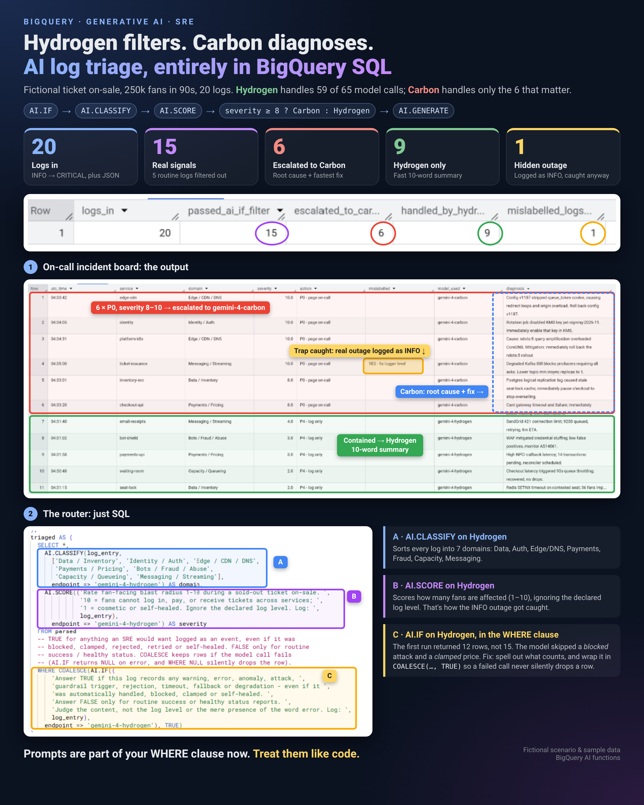
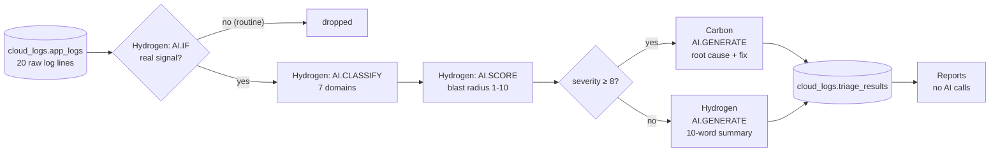

# 🎟️ BigQuery AI Log Triage

> ### ⚛️ Hydrogen filters. Carbon diagnoses. All inside BigQuery.

**A two-tier AI log triage router written entirely in BigQuery SQL, using Gemini Hydrogen and Gemini Carbon.**
**Hydrogen** (`gemini-4-hydrogen`) runs `AI.IF`, `AI.CLASSIFY` and `AI.SCORE` on every log to filter noise and rank the blast radius. Only severity ≥ 8 incidents are escalated to **Carbon** (`gemini-4-carbon`) for root cause and fix via `AI.GENERATE`. No pipelines, no Python, no orchestration. Just SQL.

**Result:** 59 of 65 model calls (~91%) ran on Hydrogen. Carbon was called only 6 times, for the incidents that mattered.




---

## Table of contents
- [Why](#why)
- [How it works](#how-it-works)
- [The sample data (and the two traps)](#the-sample-data-and-the-two-traps)
- [Quick start](#quick-start)
- [Results](#results)
- [Lessons learned](#lessons-learned)
- [Cost and design notes](#cost-and-design-notes)
- [Adapting it to your logs](#adapting-it-to-your-logs)
- [Repo layout](#repo-layout)

---

## Why

> **250,000 fans. 90 seconds. 20 log lines. Which ones should wake up on-call?**

During a high-traffic event, on-call engineers get flooded with logs. Most are routine, some are contained and self-heal, and a few are cascading outages. Sending **every** log to a large model is slow and expensive. Sending **none** means a human has to read them all.

This repo shows a **model cascade** built entirely in BigQuery SQL:

- ⚡ **Hydrogen**, the fast, high-volume tier, handles filtering, classification, scoring and short summaries on every log.
- 🧠 **Carbon**, the deep-reasoning tier, is called only for the few incidents that really matter.

## How it works



| Stage | Function | Model | Output |
|---|---|---|---|
| Filter | `AI.IF` | **Hydrogen** (`gemini-4-hydrogen`) | `BOOL`: keep or drop |
| Classify | `AI.CLASSIFY` | Hydrogen | one of 7 domains |
| Score | `AI.SCORE` | Hydrogen | `FLOAT64` blast radius 1–10 |
| Diagnose (severity ≥ 8) | `AI.GENERATE` | **Carbon** (`gemini-4-carbon`) | root cause + fastest mitigation (≤ 16 words) |
| Diagnose (severity < 8) | `AI.GENERATE` | Hydrogen | triage summary (≤ 10 words) |

The router also computes, with plain SQL:
- `action`: `P0 - page on-call` (≥ 8) / `P2 - open ticket` (≥ 5) / `P4 - log only`
- `level_mislabelled`: TRUE when the log says `INFO`/`DEBUG` but the AI scores it ≥ 8
- `event_ts` and `declared_level`: parsed from both plain-text and JSON log lines

## The sample data (and the two traps)

**Scenario (fictional):** the *"AURORA World Tour – Mumbai"* ticket on-sale on a made-up platform, **TixNova**. Tickets go on sale at 10:00 IST and 250k fans join the waiting room within 90 seconds.

| Tier | Count | Examples | Expected route |
|---|---|---|---|
| Routine INFO | 5 | queue open, seat-map publish, CDN purge, push batch, SLO report | dropped by `AI.IF` |
| Single-service WARN/ERROR | 9 | bot attack blocked, seat-lock race, price guardrail, SMTP 421, slow UPI callbacks, model drift, resale rejection (**JSON**), cosmetic gRPC timeout | Hydrogen |
| Cascading P0 | 6 | oversold seats, checkout circuit breaker open, CDN cookie-strip redirect loop, disabled JWT signing key, CoreDNS NXDOMAIN storm, ticket issuance stalled | **Carbon** |

### 🪤 Trap #1: the word "error" in a healthy log
```
INFO slo.report error_rate=0.00% errors_total=0 error_budget_burn=0.0x verdict="no errors detected"
```
A keyword filter would flag this. `AI.IF` should **drop** it.

### 🪤 Trap #2: a P0 outage logged at INFO
```
INFO heartbeat status=ok tickets_issued_last_5m=0 expected_last_5m~9000 paid_orders_without_ticket=52310 isr=1/3
```
A level-based filter would ignore this. The router should **escalate** it and flag `level_mislabelled = TRUE`.

## Quick start

### Prerequisites
- A Google Cloud project with **BigQuery** and the **Vertex AI API** (`aiplatform.googleapis.com`) enabled.
- Access to the BigQuery AI functions `AI.IF`, `AI.CLASSIFY`, `AI.SCORE` and `AI.GENERATE`.
- IAM: `roles/bigquery.jobUser` and `roles/aiplatform.user`. Grant these to your user, or to a connection's service account if you use `connection_id`.

> [!NOTE]
> The scripts pass only `endpoint =>`, so the AI functions run with **your own credentials**. For scheduled or production jobs, add `connection_id => 'PROJECT.LOCATION.CONNECTION'` to each AI function call.

### Run
Run the files in order in the BigQuery console, or with the `bq` CLI:

```bash
bq query --use_legacy_sql=false < sql/01_create_sample_logs.sql   # schema + 20 sample logs
bq query --use_legacy_sql=false < sql/02_triage_router.sql        # AI triage -> triage_results
bq query --use_legacy_sql=false < sql/03_reports.sql              # reports (no AI calls)
```

> [!TIP]
> **Model endpoints:** the scripts use `gemini-4-hydrogen` (Hydrogen, fast tier) and `gemini-4-carbon` (Carbon, deep-reasoning tier). To use other models, find and replace those two names across `sql/` and `diagnostics/`.

## Results

**Router funnel** (`03_reports.sql`, Step 3c):

| logs_in | passed_ai_if_filter | escalated_to_carbon | handled_by_hydrogen | mislabelled_logs_caught |
|---:|---:|---:|---:|---:|
| 20 | 15 | 6 | 9 | 1 |

**On-call incident board** (Step 3a, top rows from one run):

| service | domain | severity | action | mislabelled | diagnosis |
|---|---|---:|---|---|---|
| edge-cdn | Edge / CDN / DNS | 10 | P0 | | Config v1187 stripped queue_token cookie, causing redirect loops and origin overload. Roll back config v1187. |
| identity | Identity / Auth | 10 | P0 | | Rotation job disabled KMS key jwt-signing-2026-11. Immediately enable that key in KMS. |
| platform-k8s | Edge / CDN / DNS | 10 | P0 | | ndots:5 query amplification overloaded CoreDNS. Immediately roll back the ndots:5 rollout. |
| ticket-issuance | Messaging / Streaming | 10 | P0 | **YES** | Degraded Kafka ISR blocks producers requiring all acks. Lower topic min.insync.replicas to 1. |
| inventory-svc | Data / Inventory | 8 | P0 | | Postgres logical replication lag caused stale seat-lock cache; immediately pause checkout to stop overselling. |
| checkout-api | Payments / Pricing | 8 | P0 | | Card gateway timeout and failure; immediately pause waiting room admissions. |
| email-receipts | Messaging / Streaming | 4 | P4 | | SendGrid 421 connection limit; 9200 queued, retrying, 6m ETA. |
| bot-shield | Bots / Fraud / Abuse | 3 | P4 | | WAF mitigated credential stuffing; low false positives, monitor AS14061. |

> [!NOTE]
> LLM output isn't deterministic. Scores and wording will vary slightly between runs, but the gap between the two groups (severity 8–10 vs. 1–4) should hold. Some AI fixes are short-term mitigations; for example, lowering `min.insync.replicas` trades durability for availability. Treat them as on-call hints, not runbooks.

## Lessons learned

**1. Prompts are part of your `WHERE` clause. Treat them like code.**
The first version of the filter asked *"Does this log show a **real problem**?"* It returned **12 rows instead of 15**. The model reasonably decided that a *blocked* bot attack, a *clamped* price and a *rejected* resale listing were "not problems". The fix was to spell out exactly what counts:

```sql
'Answer TRUE if this log records any warning, error, anomaly, attack, guardrail trigger,
 rejection, timeout, fallback or degradation - even if it was automatically handled,
 blocked, clamped or self-healed. Answer FALSE only for routine success or healthy status.'
```

**2. Never let a failed model call silently drop a row.**
`AI.IF` can return `NULL` when a call fails, and `WHERE NULL` quietly removes the row. Wrapping it keeps those rows:

```sql
WHERE COALESCE(AI.IF((...), endpoint => '...'), TRUE)
```

**3. Score the content, not the label.**
Telling `AI.SCORE` to *"ignore the declared log level"* is how the INFO-level ticket-issuance outage got caught.

Use [`diagnostics/find_dropped_rows.sql`](diagnostics/find_dropped_rows.sql) to see which rows the filter dropped and whether `AI.IF` answered `FALSE` or `NULL`.

## Cost and design notes

- **Results are saved once.** Step 2 writes `cloud_logs.triage_results`, and all three reports read from it with **0 AI calls**.
- **Hydrogen carries the volume, Carbon carries the depth:**

  | Model | AI.IF | AI.CLASSIFY | AI.SCORE | AI.GENERATE | Total |
  |---|---:|---:|---:|---:|---:|
  | Hydrogen | 20 | 15 | 15 | 9 | **59 (~91%)** |
  | Carbon | – | – | – | 6 | **6 (~9%)** |
- **Mixed formats:** plain-text and JSON log lines are parsed in the same query (`STARTS_WITH(log_entry, '{')`).

## Adapting it to your logs

1. Point `02_triage_router.sql` at your own table. It only needs `service` and `log_entry` columns.
2. Rewrite the **domains** in `AI.CLASSIFY` to match your org (for example `Kubernetes`, `Networking`, `Storage`).
3. Rewrite the **`AI.SCORE` rubric** around your users ("fan-facing" → "customer-facing", "merchant-facing", …).
4. Tune the **escalation threshold** (`severity >= 8`) to fit your on-call budget.
5. For production, add `connection_id`, filter by time partition, and run it as a scheduled query.

## Repo layout

```
bigquery-ai-log-triage/
├── README.md
├── sql/
│   ├── 01_create_sample_logs.sql   # schema + 20 fictional sample logs (2 traps)
│   ├── 02_triage_router.sql        # AI.IF -> AI.CLASSIFY -> AI.SCORE -> AI.GENERATE
│   └── 03_reports.sql              # incident board, domain rollup, funnel (no AI calls)
├── diagnostics/
│   └── find_dropped_rows.sql       # debug the AI.IF filter (FALSE vs NULL)
└── docs/
    └── overview.png                # annotated results + SQL
```

---

<sub>The company, event, services and log data in this repo are fictional and for demonstration only. Venue names are used for illustration only.</sub>
